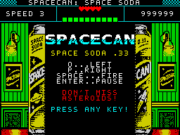

# SpaceCan — Space Soda 0.33 L

[Русский](#русский) · [English](#english)



*ZX Spectrum 48K space shooter. / Космическая аркада для ZX Spectrum 48K.*

## Русский

**SpaceCan** — космическая аркада для **ZX Spectrum 48K** и совместимых машин. Управляйте маленьким кораблём в узком коридоре, уворачивайтесь от астероидов и уничтожайте их выстрелами. На фоне движется звёздное поле, а по мере набора очков растёт скорость. В конце текущего демо вас ждёт большой корабль-босс с двумя пушками.

**Основные возможности:** анимированные астероиды двух размеров, четыре жизни, до шести пуль игрока, счёт и десятисегментная шкала опасности, приоритетные предупреждения `MOVE!` и `SHOOT!`, пауза. Финальный босс использует фиксированный **MIX**: прицельные, веерные, плазменные, двойные и самонаводящиеся выстрелы. В центре HUD во время боя — **AVOID** и пурпурная пиктограмма несбиваемой плазмы. Музыка и эффекты есть в версиях с AY и без AY.

**Управление**

| Клавиша | Действие |
|---|---|
| **O** | Влево |
| **P** | Вправо |
| **SPACE** | Выстрел (одно нажатие — одна пуля) |
| **ENTER** | Пауза / продолжить |
| **Любая клавиша** | Начать игру из меню |

Если долго не двигаться, появится `MOVE!` (предупреждение приоритетнее `SHOOT!`); за три пролёта без движения начисляется штраф. Если движение есть, но астероиды не уничтожаются, действует `SHOOT!`. Общая шкала заполняется за нарушения, после десяти делений снимается жизнь. Во время финального боя этот же индикатор показывает здоровье босса. Потеря жизни сбрасывает астероиды к верхней границе, оставляя время на уклонение.

**Предфинальная демоверсия:** [с AY (SpaceCan-AY.tap)](https://github.com/knowsbetteralex/SpaceCan/releases/latest/download/SpaceCan-AY.tap) · [без AY (SpaceCan-Beeper.tap)](https://github.com/knowsbetteralex/SpaceCan/releases/latest/download/SpaceCan-Beeper.tap) · [все релизы](https://github.com/knowsbetteralex/SpaceCan/releases).

Оба TAP содержат BASIC-загрузчик: выполните `LOAD ""`. Версия с AY использует четыре независимых **AYM2 v1**-трека: меню, полёт, победа, поражение. При входе в меню и после победы/поражения сначала звучит отдельная биперная мелодия, **затем AY**. Три биперные мелодии различаются; короткий звук паузы — отдельный эффект. Финальные AY-треки пока временные, окончательные будут добавлены перед финальным релизом. На доработанной Delta-C проверена игра с нормальным кадровым INT.

## English

**SpaceCan** is a space shooter for the **ZX Spectrum 48K** and compatible machines. Pilot a small ship through a narrow corridor, dodge incoming asteroids, and shoot them down. A moving starfield creates the sensation of flight, and the game speeds up as your score increases. The current demo finishes with a large twin-cannon boss ship.

**Features:** animated asteroids, four lives, up to six player bullets, a ten-segment danger gauge, prioritized `MOVE!` / `SHOOT!` warnings, pause, and a final boss with fixed **MIX** (aimed, fan, invulnerable plasma, double, and homing attacks). The six-cell boss HUD says **AVOID** followed by the actual magenta plasma sprite. Two builds are available, with or without AY.

**Controls**

| Key | Action |
|---|---|
| **O** | Move left |
| **P** | Move right |
| **SPACE** | Fire (one shot per key press) |
| **ENTER** | Pause / resume |
| **Any key** | Start from the title screen |

Not moving triggers `MOVE!` and a penalty after three screen traversals; while moving, missed asteroid kills trigger `SHOOT!` and its own penalty. Both use the same ten-segment gauge. During the final boss encounter, the same gauge displays the boss's remaining health. When you lose a life, asteroids restart from the top, giving you time to react.

**Pre-final downloads:** [AY version](https://github.com/knowsbetteralex/SpaceCan/releases/latest/download/SpaceCan-AY.tap) · [beeper-only version](https://github.com/knowsbetteralex/SpaceCan/releases/latest/download/SpaceCan-Beeper.tap) · [all releases](https://github.com/knowsbetteralex/SpaceCan/releases).

Both TAPs autostart with `LOAD ""` on a ZX Spectrum 48K. The AY build embeds four AYM2 v1 tunes (menu, game, victory, defeat); three **different** beeper scene jingles precede the AY music on the menu and ending screens. Victory/defeat AY tunes are currently placeholders awaiting final compositions.

## Development / Разработка

The game is written in **Z80 assembly** for [sjasmplus](https://github.com/z00m128/sjasmplus), with modular source code starting at [main.asm](main.asm). A standalone source is also available for portable assemblers.

Для сборки из исходников (sjasmplus + Python 3):

```bash
sjasmplus --nologo --raw=SpaceCan.bin main.asm
python3 make_tap.py SpaceCan.bin SpaceCan.tap
```

Изменяемые параметры игрового процесса и звука находятся в верхней части `main.asm`, в том числе `DEMO_SPEEDUP_SCORE`, `DEMO_BOSS_SCORE`, `AY_MUSIC_ENABLED` и `BEEPER_ENGINE_ENABLED`. AY-флаг автоматически выставляется в 1 или 0 при выпуске двух TAP; `BEEPER_ENGINE_ENABLED` по умолчанию остаётся **0**. Для локальной сборки обоих вариантов используйте `python3 build_variants.py dist` (нужен sjasmplus в PATH).

- [CHANGELOG.md — история изменений / development history](CHANGELOG.md)
- [docs/ — техническая документация / technical documentation](docs/)
- [Анализ сжатия AY-музыки / AY music compression analysis](docs/aym_compression_analysis.md) — предварительное ТЗ AYM2 и замеры на текущих треках
- [GitHub Releases — TAP builds / сборки игры](https://github.com/knowsbetteralex/SpaceCan/releases)

*The screenshot above is a static artwork/HUD preview, not a gameplay capture. / Изображение выше — статический макет заставки и панели, а не скриншот игрового процесса.*
