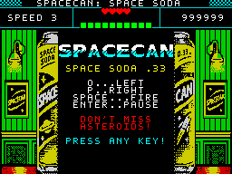

# SpaceCan — Space Soda 0.33 L

[Русский](#русский) · [English](#english)



*ZX Spectrum 48K space shooter. / Космическая аркада для ZX Spectrum 48K.*

## Русский

**SpaceCan** — космическая аркада для **ZX Spectrum 48K** и совместимых машин. Управляйте маленьким кораблём в узком коридоре, уворачивайтесь от астероидов и уничтожайте их выстрелами. На фоне движется звёздное поле, а по мере набора очков растёт скорость. В конце текущего демо вас ждёт большой корабль-босс с двумя пушками.

**Основные возможности:** анимированные астероиды двух размеров, четыре жизни, до шести одновременно выпущенных пуль, счёт и индикатор опасности, предупреждение `SHOOT!` при долгом отсутствии уничтожений, пауза и звуковые эффекты. Музыка использует бипер и, при наличии, **AY**.

**Управление**

| Клавиша | Действие |
|---|---|
| **O** | Влево |
| **P** | Вправо |
| **SPACE** | Выстрел (одно нажатие — одна пуля) |
| **ENTER** | Пауза / продолжить |
| **Любая клавиша** | Начать игру из меню |

Если слишком долго не уничтожать астероиды, растёт десятисегментный индикатор штрафа. Во время финального боя этот же индикатор показывает здоровье босса. Потеря жизни сбрасывает астероиды к верхней границе, оставляя время на уклонение.

**Скачать игру:** [последний TAP](https://github.com/knowsbetteralex/SpaceCan/releases/latest) · [все релизы](https://github.com/knowsbetteralex/SpaceCan/releases).

TAP содержит BASIC-загрузчик: в обычном режиме ZX Spectrum выполните `LOAD ""`, и игра запустится автоматически. Для запуска необходима 48-килобайтная модель ZX Spectrum или совместимый эмулятор; AY необязателен для сборки без AY.

## English

**SpaceCan** is a space shooter for the **ZX Spectrum 48K** and compatible machines. Pilot a small ship through a narrow corridor, dodge incoming asteroids, and shoot them down. A moving starfield creates the sensation of flight, and the game speeds up as your score increases. The current demo finishes with a large twin-cannon boss ship.

**Features:** animated asteroids in two sizes, four lives, up to six player bullets, scoring and a danger meter, a blinking `SHOOT!` warning when you stop destroying asteroids, pause support, and sound effects. The game supports beeper audio and optional **AY** music.

**Controls**

| Key | Action |
|---|---|
| **O** | Move left |
| **P** | Move right |
| **SPACE** | Fire (one shot per key press) |
| **ENTER** | Pause / resume |
| **Any key** | Start from the title screen |

Missing too many asteroids fills the ten-segment penalty gauge. During the final boss encounter, the same gauge displays the boss's remaining health. When you lose a life, asteroids restart from the top, giving you time to react.

**Download:** [latest TAP](https://github.com/knowsbetteralex/SpaceCan/releases/latest) · [all releases](https://github.com/knowsbetteralex/SpaceCan/releases).

The TAP includes a BASIC loader: type `LOAD ""` on a ZX Spectrum to load and start the game automatically. Requires a ZX Spectrum 48K or compatible emulator. AY sound is optional when compiled without AY support.

## Development / Разработка

The game is written in **Z80 assembly** for [sjasmplus](https://github.com/z00m128/sjasmplus), with modular source code starting at [main.asm](main.asm). A standalone source is also available for portable assemblers.

Для сборки из исходников (sjasmplus + Python 3):

```bash
sjasmplus --nologo --raw=SpaceCan.bin main.asm
python3 make_tap.py SpaceCan.bin SpaceCan.tap
```

Изменяемые параметры игрового процесса находятся в верхней части `main.asm`, в том числе `DEMO_SPEEDUP_SCORE` и `DEMO_BOSS_SCORE`.

- [CHANGELOG.md — история изменений / development history](CHANGELOG.md)
- [docs/ — техническая документация / technical documentation](docs/)
- [GitHub Releases — TAP builds / сборки игры](https://github.com/knowsbetteralex/SpaceCan/releases)

*The screenshot above is a static artwork/HUD preview, not a gameplay capture. / Изображение выше — статический макет заставки и панели, а не скриншот игрового процесса.*
